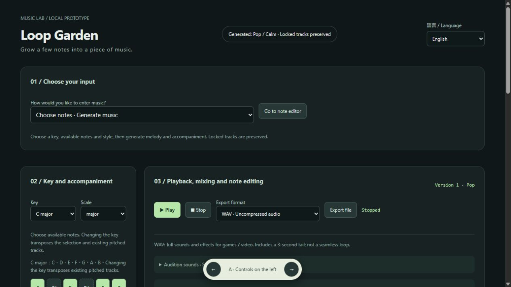

# Loop Garden

A browser-based music sketchpad: hum a melody, play your computer keyboard, draw notes, or generate an arrangement and edit it. **Experimental prototype**, with English as the default and a Traditional Chinese language switch. Your language choice is remembered on this browser.



## Run locally

Install Node.js 18 or later, then:

```sh
git clone https://github.com/arklantis/loop-garden.git
cd loop-garden
npm start
```

Open http://127.0.0.1:8766/ . No dependency installation, API key or account is required. Click Play to enable browser audio. The local server must stay running while you use the app.

This is a static browser app. You can also serve these files from a remote static host; microphone access requires HTTPS (localhost is allowed for development). The included server deliberately listens only on localhost and is a development helper, not a public hosting server. Publishing this repository alone does not publish a playable website.

## What you can do

- Choose microphone, computer keyboard, mouse, automatic generation, music-file import or AI copy/paste input. The note editor remains available after transcription.
- Edit four tracks: melody, chord accompaniment, bass and rhythm. Lock tracks while regenerating the others.
- Choose major or natural minor keys, 2/4/8 bars in 4/4, seven style directions, mood, tempo and a repeatable random seed.
- Use sampled piano, guitar, orchestral solo/section instruments, synthesizers, drums and explicitly labelled synthetic Chinese-instrument approximations.
- Draw notes, drag their duration, use exact duration buttons down to sixteenth notes, and use the context menu. Physical computer keys act like piano keys.
- Use available bowed/plucked string articulations, guitar voicings, strums, arpeggios, panning, delay and reverb.
- Save/open the complete Loop Garden JSON project. Copy an arrangement request to your preferred AI and paste its JSON response back; there is no built-in AI service or subscription integration.

## Import and export

| Format | Import | Export |
| --- | --- | --- |
| Loop Garden JSON | Complete project; pasted JSON or JSON/text file | Complete editable project |
| MIDI | Type 0/1, fixed tempo; choose a fragment and map up to four parts | Type 1, tempo/key metadata, approximate General MIDI programs |
| MusicXML | Uncompressed score-partwise XML; selected parts and fragment | Four-part score with notes, rests and ties |
| WAV / MP3 | Audio transcription, not recovery of the original project | Stereo audio rendered with the app's sounds and effects |
| Other browser-decodable audio | OGG/M4A/AAC/FLAC/WebM when supported by your browser | No |

## Current limits

- Humming works best with one clear voice and no accompaniment. Beatbox recognition is a rough onset classifier. Transcription can make pitch/timing mistakes; review the notes. Audio input is limited to 45 seconds / 30 MB.
- Mixed songs cannot be separated into a complete score or stems. Tempo is not automatically recovered from audio.
- Fixed four tracks, 4/4 meter, 2/4/8 bars and 50–180 BPM. This is a short-phrase tool, not a complete DAW.
- MIDI tempo changes, SMPTE timing and type 2 files are unsupported. Compressed MXL and MusicXML repeats/layout are unsupported. Score imports are limited to 5 MB.
- MIDI/MusicXML do not preserve the app's sample sound or full effects. Keep JSON for the most faithful editable project.
- WAV/MP3 exports include a three-second effect tail; seamless loop export is not implemented.
- Sparse samples are transposed across notes. Chinese instruments and vowels are approximations, not authentic recordings or a real choir.
- No Mercury command interpreter is included.

## Privacy and saved work

Recording, transcription, imported files, synthesis and encoding run in your browser. The app does not upload recordings or call an AI API. Microphone access asks for browser permission. Export your project JSON to keep a durable copy; the language setting is stored locally. Files pasted into an external AI are subject to that service's own policies.

## Development

Plain HTML, CSS and JavaScript; no build step. Run `npm run check` for JavaScript syntax checks. This is not a comprehensive automated audio or browser test suite. Test changes in a browser, including playback, both languages and a project save/open round trip.

Start with `app.js` (project/audio engine), `piano-roll.js` (editing), `hum.js` and `pitch-worker.js` (transcription), `importers.js` / `exporters.js` (interchange), and `i18n.js` / `i18n-en.js` (language presentation). Original UI source strings are Traditional Chinese; the English presentation layer also translates dynamically generated controls.

Bug reports and pull requests are welcome. Include browser/version, steps, expected/actual behavior and a small non-private project file if relevant. Do not contribute samples without documented redistribution rights.

## License

Original Loop Garden code: [MIT](LICENSE). Bundled samples and the MP3 encoder retain their respective **CC BY 3.0, CC0 and LGPL** licenses. See [third-party notices](THIRD_PARTY_NOTICES.md) and [sound provenance](SOURCES.md). Attribution requirements can also matter when you distribute audio made with the samples.
